<!-- Generated by scripts/build.mjs from profile.config.json + data/profile.json. Edit those, not this file. -->

<a href="https://sarvankumar.in"><picture><source media="(prefers-color-scheme: dark)" srcset="assets/hero-light.svg">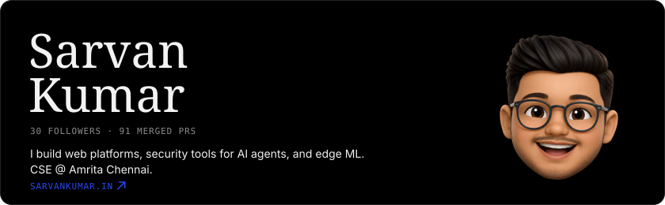</picture></a>

<a href="https://github.com/sarvan-2187"><picture><source media="(prefers-color-scheme: dark)" srcset="assets/heatmap-light.svg">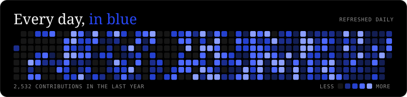</picture></a>

<a href="https://github.com/sarvan-2187?tab=repositories"><picture><source media="(prefers-color-scheme: dark)" srcset="assets/card-build-light.svg">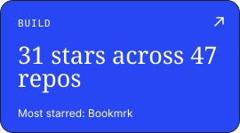</picture></a>
<a href="https://github.com/sarvan-2187?tab=repositories&q=topic:hackathon"><picture><source media="(prefers-color-scheme: dark)" srcset="assets/card-win-light.svg">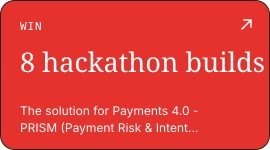</picture></a>
<a href="https://github.com/sarvan-2187/brisc-deployment"><picture><source media="(prefers-color-scheme: dark)" srcset="assets/card-research-light.svg">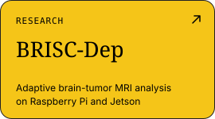</picture></a>

<picture><source media="(prefers-color-scheme: dark)" srcset="assets/coding-title-dark.svg"></picture>

<a href="https://github.com/sarvan-2187/Dhamani"><picture><source media="(prefers-color-scheme: dark)" srcset="assets/repo-1-light.svg">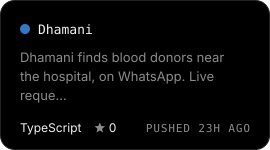</picture></a>
<a href="https://github.com/sarvan-2187/Bookmrk"><picture><source media="(prefers-color-scheme: dark)" srcset="assets/repo-2-light.svg">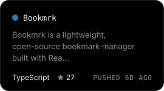</picture></a>
<a href="https://github.com/sarvan-2187/dog-food"><picture><source media="(prefers-color-scheme: dark)" srcset="assets/repo-3-light.svg">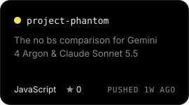</picture></a>

<picture><source media="(prefers-color-scheme: dark)" srcset="assets/profiles-title-dark.svg"></picture>

<a href="https://codeforces.com/profile/sarvan_2187"><picture><source media="(prefers-color-scheme: dark)" srcset="assets/profile-codeforces-light.svg">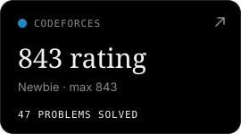</picture></a>
<a href="https://huggingface.co/sarvan-2187"><picture><source media="(prefers-color-scheme: dark)" srcset="assets/profile-hugging-face-light.svg">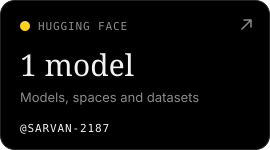</picture></a>
<a href="https://www.kaggle.com/sarvan2187"><picture><source media="(prefers-color-scheme: dark)" srcset="assets/profile-kaggle-light.svg">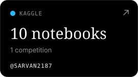</picture></a>

<a href="https://sarvankumar.in">sarvankumar.in</a> · <a href="https://linkedin.com/in/nagarampalli-sarvan-kumar">LinkedIn</a> · <a href="mailto:sarvankumarnagarampalli478@gmail.com">Email</a> · <a href="https://codeforces.com/profile/sarvan_2187">Codeforces</a> · <a href="https://www.kaggle.com/sarvan2187">Kaggle</a> · <a href="https://huggingface.co/sarvan-2187">Hugging Face</a>

